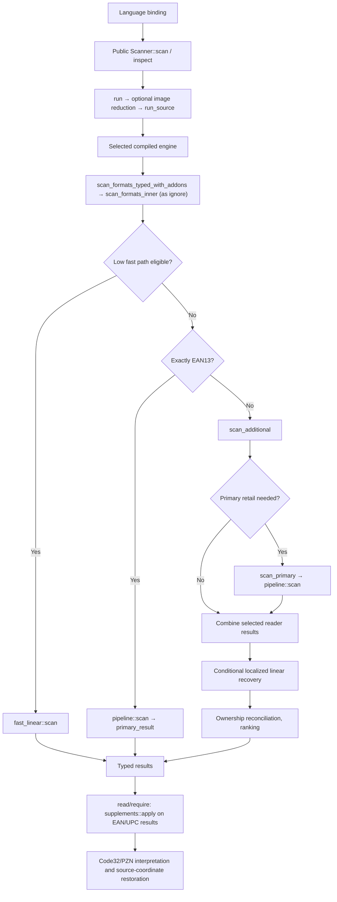

# Library execution map and structural review

Source reviewed on 20 October 2026. The tables map orchestration functions
and their important branches, rather than every sampling/decoder helper.
This execution map does not establish performance or accuracy.
“Conditional” means the function is available but its image, format, evidence
or budget checks must also pass.

## Layers

| Layer                  | Responsibility                                                            | Source                                                                                         |
| ---------------------- | ------------------------------------------------------------------------- | ---------------------------------------------------------------------------------------------- |
| Language bindings      | Input validation/conversion, ownership and result transport               | `bindings/{javascript,c,cpp,python,java,swift,android,wasm}`                                   |
| Public Rust API        | Persistent scanner, mode dispatch, large-image reduction, public results  | [api/lib.rs](../bindings/rust/api/lib.rs), [api/reduce.rs](../bindings/rust/api/reduce.rs)     |
| Per-mode orchestration | Format routing, localization, recovery ordering, reconciliation           | [formats.rs](../bindings/rust/src/formats.rs), [pipeline.rs](../bindings/rust/src/pipeline.rs) |
| Retail core            | Supplied-region EAN-13/UPC-A scanning, evidence, retries, frame ownership | [core/src](../core/src), [core guide](../core/README.md)                                       |
| Other readers          | Linear and matrix localization/decoding, shared thresholds                | [multiformat/src](../multiformat/src)                                                          |
| Build assembly         | Compile the same maintained source into private mode instances            | [prepare_rust.py](../scripts/prepare_rust.py), [modes.json](../config/modes.json)              |

Native consumers share the Rust API through one library containing all four
standard modes. JavaScript loads one WASM module per mode or Turbo preset.
Generated per-mode namespaces are compilation artifacts, not independently
maintained copies of the algorithms.

The EAN13-only branch returns directly via `primary_result`, without the general
mixed-format recovery stage. Low's fast path calls `fast_additional` for selected
formats outside its common linear set; that subcall is omitted from the diagram.

## Public entry points and routing

The entry points are in [api/lib.rs](../bindings/rust/api/lib.rs).

| Function                                   | Used when                    | Effect                                                                                                                       |
| ------------------------------------------ | ---------------------------- | ---------------------------------------------------------------------------------------------------------------------------- |
| `Scanner::scan`, `scan_with_options`       | All standard modes           | Compact barcode results; optional region output disabled                                                                     |
| `Scanner::inspect`, `inspect_with_options` | All standard modes           | Barcode results plus undecoded regions and diagnostics                                                                       |
| `run`                                      | Ordinary image input         | Validates/prepares input and applies large-image reduction when needed                                                       |
| `inspect_rows`                             | Internal WASM row-input path | Supports banded large-image input; diagnostics flag also permits compact output                                              |
| `run_source`                               | Every prepared input         | Dispatches to the compiled mode instance; subsequently applies Code32/PZN interpretation and restores reduced-image geometry |
| `scan_formats_inner`                       | Every selected engine        | Chooses Low fast path, EAN13-only shortcut, or general format orchestration                                                  |

Public calls set internal `multiple = true` and `finish_candidates = false`.
Some internal/core APIs expose additional choices; their branches should not be
mistaken for normal public defaults.

Low's `fast_linear::enabled` requires all of:

- At least one selected format is linear.
- Explicit candidate completion is off.

The EAN add-on policy does not change routing: `Read` and `Require` scan exactly as
`Ignore`, then read supplements beside the EAN/UPC results. QR-only Low does
not enter the linear fast path. Turbo presets use the Low compiled mode with
different build settings; the same routing conditions still matter.

## Linear and retail execution by mode

Sources: [fast_linear.rs](../bindings/rust/src/fast_linear.rs),
[pipeline.rs](../bindings/rust/src/pipeline.rs),
[formats.rs](../bindings/rust/src/formats.rs), and
[formats/linear_recovery.rs](../bindings/rust/src/formats/linear_recovery.rs).

| Stage/function                                  | Low                                | Medium                                                                                                              | High                                                                               | Very High                                              |
| ----------------------------------------------- | ---------------------------------- | ------------------------------------------------------------------------------------------------------------------- | ---------------------------------------------------------------------------------- | ------------------------------------------------------ |
| `fast_linear::scan`                             | Eligible linear selections         | No; shared helpers reused                                                                                           | No; shared helpers reused                                                          | No; shared helpers reused                              |
| `segment_voting::localize`                      | Ordinary fast path                 | Main retail localization and localized linear recovery                                                              | Main retail localization and localized linear recovery                             | Main retail localization and localized linear recovery |
| `pipeline::localize`                            | General/core path uses stripes     | Voting                                                                                                              | Voting; also stripes when longest side <384 px                                     | Same, plus secondary stripe proposals                  |
| `shear::refine` in primary localization         | Limit 0                            | Limit 1                                                                                                             | Limit 4                                                                            | Limit 1                                                |
| `add_secondary_proposals`                       | No                                 | No                                                                                                                  | No                                                                                 | Longest side >640 px; up to 8 boxes plus 4 refinements |
| `regions.scan` → core `scan_frame`              | General/core path                  | Primary retail candidates                                                                                           | Primary retail candidates                                                          | Primary retail candidates                              |
| Full-frame candidate in `scan_prepared_impl`    | Included in core path              | Whole frame deferred until evidence exists and earlier recovery remains unread; crop rescans include it immediately | Included initially                                                                 | Included initially                                     |
| `scan_alternatives`                             | No                                 | Conditional voting alternatives with retail evidence                                                                | Same                                                                               | Same                                                   |
| `detail::recover`                               | Not in retail pipeline             | Up to 2 small source seeds                                                                                          | Small seeds plus up to 3 wide seeds when reads are absent/weak                     | Same; more recovery directions                         |
| `recover_primary_proposals_high`                | No                                 | No                                                                                                                  | Source-confirmed retries of up to 6 eligible proposals                             | Same                                                   |
| `recover_primary_proposals`                     | No                                 | Contrast/color/high-pass and further profile hypotheses                                                             | Also runs when higher-mode work remains retail-unread and evidence permits         | Same                                                   |
| `scan_unread_window`                            | No                                 | Evidence-gated delayed full-frame scan                                                                              | No separate delayed pass                                                           | No separate delayed pass                               |
| `recover_deferred_proposals`                    | No                                 | Conditional unread-frame band recovery                                                                              | Conditional after earlier recovery                                                 | Same                                                   |
| `recover_restored_regions`                      | No                                 | Whole-frame source; additional shared-retail guard                                                                  | Whole-frame source                                                                 | Whole-frame source                                     |
| `recover_unread_crops`                          | No                                 | Whole frame with no primary or short-retail reads                                                                   | Whole frame unread, no shared non-retail linear selection, repeated guard evidence | Same                                                   |
| `recover_deblurred_crops`, `recover_downscaled` | No                                 | Conditional whole-frame unread recovery                                                                             | Conditional whole-frame unread recovery                                            | Same                                                   |
| `recover_linear_regions`                        | No                                 | General format path, selected linear formats                                                                        | Same with larger recovery policy                                                   | Same with additional windows                           |
| `linear_duplicates` reconciliation              | Fast-path or general-path variants | General/primary variants                                                                                            | General/primary variants                                                           | Additional conflict-admission implementation           |

These are stage availability rules, not a guarantee that a later mode performs
every earlier mode's operation. For example, High tries its own profile recovery
before borrowing Medium's unread-frame strategies. Crop rescans carry
`TextureSource::crop`; this preserves original-pixel texture decisions and
prevents recursive whole-frame restoration. Medium also skips repeated detail
seed recovery inside those rescans.

Medium reuses exact source profiles within each primary profile-retry stage and
within localized linear recovery. Each cache scope belongs to one immutable image;
normal return and unwinding clear its active identity. Recursive crop scans start
outside the primary retry scope. High and Very High keep uncached primary retries.

Low has its own bounded contrast/high-pass recovery and EAN-13 deghosting in
`fast_linear::scan`. “No” in the main-pipeline rows does not mean that Low has
no recovery.

The core path is:
`region_scan::RegionScanner::scan` → `frame::scan_frame` → candidate scanning
and `multi_scan` planning/execution → frame reconciliation.
Relevant implementations are [candidate_scanner](../core/src/candidate_scanner),
[multi_scan/plan.rs](../core/src/multi_scan/plan.rs),
[multi_scan.rs](../core/src/multi_scan.rs),
[lowres.rs](../core/src/lowres.rs), and [frame](../core/src/frame).
They contain real compile-time algorithm differences; the host budget table
alone cannot describe the mode.

## Format readers and recovery policies

`scan_additional` partitions the selection into linear sweep groups, a matrix
group, and separate QR/MaxiCode groups where required. Native execution can run
groups concurrently; WASM executes them sequentially. Results retain defined
group order. Threshold images can be shared.

Low can first use `fast_sparse::Prepared::scan` for eligible groups: it excludes
constant backgrounds or tries a small foreground crop, falling back to the source
scan when the crop remains unresolved. Medium also uses this helper in its
conditional DataBar retry. It ultimately calls `scan_reader` with the selected
image; it is not a separate decoder.

`scan_reader_with` dispatches:

| Selection of the reader group      | Function                                |
| ---------------------------------- | --------------------------------------- |
| Matrix-only group containing Aztec | `matrix_frontend::scan`                 |
| Exactly QR Code                    | `core::qr_frontend::scan_with_images`   |
| Other groups                       | `barcode_multiformat::scan_with_images` |

The matrix frontend and multiformat orchestration call the same detector
implementations: `qr_detect::detect_group`, `dm_detect::detect`,
`aztec_detect::detect`, `maxicode_detect::detect`, and `pdf417::detect`.
The QR-only frontend adds threshold and sharpened retries around the shared
QR detector.

Selected values from [formats/policy.rs](../bindings/rust/src/formats/policy.rs)
and [effort.rs](../bindings/rust/src/effort.rs):

| Policy                                                       | Low | Medium  | High       | Very High           |
| ------------------------------------------------------------ | --- | ------- | ---------- | ------------------- |
| Primary proposal limit                                       | 32  | 32      | 32         | 63                  |
| Detail recovery directions                                   | —   | 1       | 1          | 2                   |
| Base ordinary linear sweep effort                            | 0   | 0       | 2          | 2                   |
| Supplement profiles (`read`/`require`)                       | 3   | 5       | 9          | 9                   |
| QR group effort                                              | 0   | 1       | 2          | 3                   |
| Other matrix group base effort                               | 1   | 1       | 1          | 1                   |
| Shared short-retail scan                                     | No  | Yes     | Yes        | Yes                 |
| Source-profile cache in primary and localized linear retries | —   | Yes     | No         | No                  |
| Full stripe fallback / half-scale proposals                  | —   | No / no | Yes / yes  | Yes / yes           |
| Overlapping window proposals                                 | —   | No      | No         | Yes                 |
| Localized matrix crop pixel allowance                        | 0   | 65,536  | 131,072    | 262,144             |
| Localized matrix crop effort                                 | 0   | 1       | 2          | 3                   |
| Policy-driven reduced QR long sides                          | —   | —       | 1200, 1280 | 1200, 1280, 1600    |
| Area-averaged Data Matrix long sides                         | —   | —       | 256, 400   | 400, 1008, 800, 256 |

The base sweep effort is not a universal “Common1D effort.” Preserved
Code128/Code39/ITF groups have separate selection and effort rules; High and
Very High can also run a coarse effort-0 sweep because denser scanlines do not
contain the sparse scanlines. Medium's `medium_retries` independently has
960/1280 QR reductions on large unread inputs and an effort-2 retry for pending
QR regions on smaller inputs. Low also has a conditional 960-pixel QR retry.
Consequently, the dash in the policy-driven reduction row does not mean no
reduction exists anywhere in that mode.

Detector policy is separate from group effort:

- QR `Policy::for_mode` gives Low/Medium alignment budgets of 150/25; High and
  Very High have no finite alignment counter cap there, but other pass limits
  still apply. Gray retry is off/hard/erasures/erasures. Very High's effort
  enables curved-grid attempts. These values are deliberately not monotonic.
  The gray pass computes confidence margins only for erasure retries. Normal
  orientation borrows the sampled matrix; mirrored attempts share a transpose
  helper across hard decoding and both erasure-retry paths.
- Aztec `Policy::for_mode` uses smaller Low refinement/curve budgets and no bowed
  or adaptive sampling; Medium and above share its standard policy. The detector
  also receives the compiled mode for mode-dependent enlarged retries.
- Data Matrix and PDF417 receive the compiled mode even when their group effort
  stays at 1. Equal group effort therefore does not imply equal execution.

## Turbo presets

Sources: [fast_linear.rs](../bindings/rust/src/fast_linear.rs),
[build_turbo.py](../scripts/build_turbo.py). These are public experimental
presets, not additional standard effort modes. This table describes their
eligible linear fast path, not every possible format/add-on selection.

| Setting                        | Turbo2                       | Turbo4             | Turbo8                              | Turbo16                       |
| ------------------------------ | ---------------------------- | ------------------ | ----------------------------------- | ----------------------------- |
| Localization                   | Sparse stripes with recovery | Same               | Same                                | Sparse stripes                |
| Working dimension setting      | 768                          | 384                | 320                                 | 128                           |
| Main profile rows              | 13                           | 5                  | 5                                   | 3                             |
| General sample limit           | 3072                         | 2048               | 2048                                | 2048                          |
| Ordinary localized-profile cap | 1024                         | 768                | 576                                 | 512                           |
| Full-frame axis proposals      | Scheduled                    | Scheduled          | Rescue when local pass unread       | Rescue when local pass unread |
| Border discovery               | Yes                          | Yes                | No                                  | No                            |
| Extra build setting            | Selective outlines           | Selective outlines | Selective outlines; profile cap 576 | Direct sampling               |

All four recipes enable band outlines, tile cache and finite-extrema settings,
and disable the ordinary display-outline path. Turbo8/16 have distinct axis-row
and confirmation rules; substituting a different row count alone does not
reproduce a preset.

## Structural findings

### 1. Localized linear recovery has its own stage module

[formats/linear_recovery.rs](../bindings/rust/src/formats/linear_recovery.rs) owns
`recover_linear_regions`, its proposal helpers and local work limits. The format
coordinator calls that stage after combining initial reader results. Recovery
keeps its ordered passes, shared sampler and existing ownership checks.

`formats.rs` still coordinates reader groups, matrix retries, supplement policy
and final results. Further extraction should follow a complete stage boundary:
`medium_retries`, for example, handles Code128 and DataBar as well as matrix
formats, so moving it into a matrix-only module would misdescribe its role.

### 2. Recovery selection shares evidence but keeps distinct policies

In [pipeline.rs](../bindings/rust/src/pipeline.rs), `recovery_evidence` supplies
one predicate to primary profile retries and deferred-proposal exclusion.
Protected ownership, stable guard-pass ordering, proposal limits and recovery
strategies remain at their call sites because they differ between passes.
Primary recovery reuses the selected proposals for later dense profiles.

### 3. Matrix readers share invocation and order

[matrix_readers.rs](../multiformat/src/matrix_readers.rs) defines the fixed reader
order and detector calls with mode policies. Both the parallel matrix frontend
and multiformat scanner use it. Their orchestration remains separate:
multiformat observers see cumulative work-limit flags, while the frontend can
run readers concurrently and falls back to sequential execution if private
regions would exceed the shared cap.

Their finalization is also different: multiformat `linear_geometry::distinct`
can join partial fragments; the matrix frontend only removes overlapping
duplicates. Sharing detector invocation does not merge these ownership rules.

QR enhancement and the host's matrix recovery passes share
[`qr_enhance::sharpen`](../multiformat/src/qr_enhance.rs). The filter uses the same
integer rounding, replicated image edges and fixed sharpening strength at each
call site; the callers retain their own recovery triggers and pixel budgets.

### 4. Mode configuration is spread across several legitimate layers

Mode decisions live in `effort.rs`, `formats/policy.rs`, core feature branches,
reader `Policy::for_mode` functions and Turbo build settings. Inheritance such as
`HIGH { ..MEDIUM }` makes the complete effective policy harder to see.

**Recommendation:** keep algorithm-specific decisions near their algorithms.
Use this map and the existing policy tables to expose the effective values.
If drift becomes frequent, generate a small policy report from the authoritative
definitions. Replacing everything with one enormous runtime configuration would
add complexity and weaken compile-time specialization.

`ScanContext` carries output options, consolidation and shared-format decisions
through primary scanning and recursive crop recovery. Crop rescans retain the
mixed-linear restriction while resetting their retail and consolidation policy
explicitly. These decisions are no longer temporary mutable state on `Scanner`.
`matrix_frontend::with_parallel` still uses a scoped, restored thread-local
setting; this review did not demonstrate a correctness bug in that mechanism.

## Complexity worth preserving

- Different deduplication stages have different ownership contracts: candidate
  assembly, source-confirmed recovery admission, cross-format reconciliation and
  display geometry are not interchangeable.
- Similar interpolation or luminance code may use different rounding, precision,
  coordinate conventions or input layouts. Visual similarity is insufficient
  evidence that two implementations can be merged.
- Sparse and denser scans can cross different rows; “more effort” is not a
  superset of all earlier work.
- `TextureSource`, coverage masks, support checks and explicit work-limit flags
  encode correctness requirements. Flattening them into generic success/failure
  flags would lose information.
- Per-mode generated source copies and thin language adapters are justified
  packaging boundaries, not duplicated scanner implementations.

Scanner changes still require isolated worktrees and paired correctness checks
across modes and format selections. Preserve output ordering, source geometry,
undecoded coverage and work-limit behavior. Performance claims require paired
measurements through the public JavaScript API in installed Chrome; see
[comparing scanners](COMPARING_SCANNERS.md).
